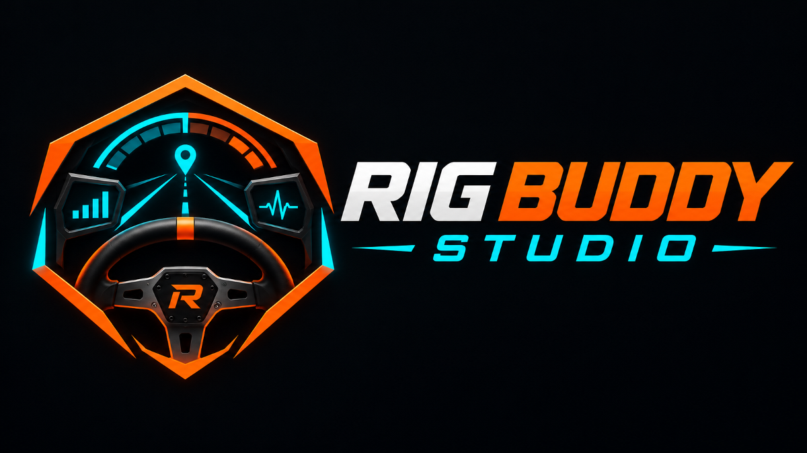
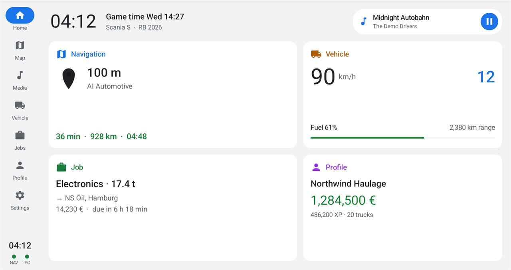
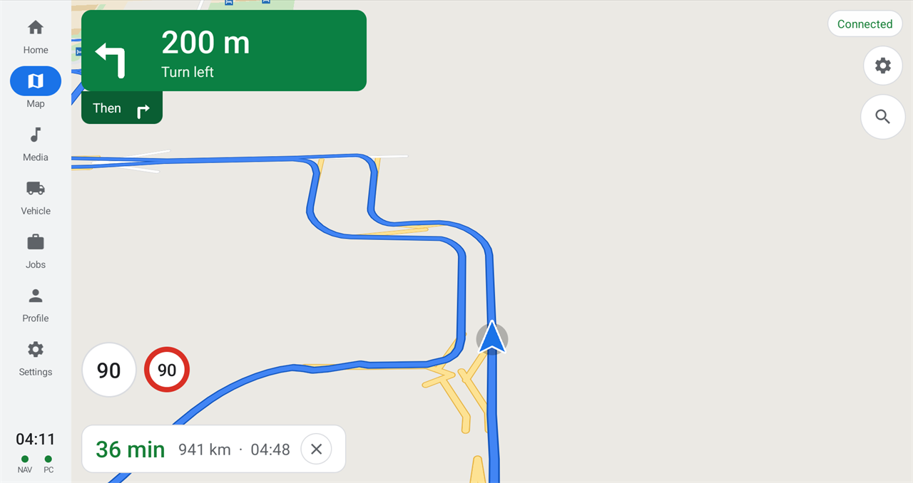

<p align="center"></p>

<p align="center">
  The control room of a truck-sim rig, in one Windows tray app.<br>
  Navigation, a trip computer and a button box on your tablet.
</p>

<p align="center">
  Free · Open source (GPL-3.0) · <b>English</b> · <a href="#turkce">Türkçe</a>
</p>

<p align="center">
  
  
</p>
<p align="center"><sub>Android app screenshots use demo data</sub></p>

---

<a id="english"></a>

## What it is

Rig Buddy Studio sits next to Euro Truck Simulator 2 or American Truck Simulator.

**On a phone, tablet or head unit** it is a cockpit: a map and turn-by-turn guidance on the
game's own roads, a trip computer, the freight market, your profile, the radio, a music
remote, sound-mod switches and a **button box** that presses keys in the game.

Everything is set up in the app's window (native Windows, not a web page). There is
no file to edit and no code to write.

## Features

- **Games:** Euro Truck Simulator 2, American Truck Simulator, Assetto Corsa.
- **Navigation (ETS2/ATS):** routing on the game's road network, lane and turn
  guidance, trip computer. The map is built from your own installation, so every
  map DLC you own is in it.
- **Button box (ETS2/ATS):** pages of large touch buttons that press the game's keys
  on the PC.
  - 103 functions to choose from (lights, indicators, wipers, brakes, retarder, cruise
    control, cameras, axles, radio, quick save...), 57 icons, colours.
  - A button uses either your own key or the one the game has for that function in
    `controls.sii`. Tap or hold while pressed.
  - Drag the corner of a button in edit mode to make it wider or taller.
  - Ready-made pages (lights, gearbox and brakes, cameras, cabin and radio, driver assist).
  - The buttons grey out while the game is not in front, and a warning shows when two
    buttons on a page press the same key.
  - Safety: keys reach only the game window, only while it is in front; combinations
    that would leave the game (Alt+F4, Alt+Tab, Ctrl+Esc) are refused; held keys are
    released when the tablet leaves.
- **Live telemetry on the PC:** the window shows the game's live values and lists
  every value the game reports.
- **Sound mods:** FMOD sound mods through the bundled sound plugin
  (based on [ts-fmod-plugin](https://github.com/dariowouters/ts-fmod-plugin), MIT).
- **Seven languages:** English, Türkçe, Deutsch, Русский, Português, Español, Français
  (the main window is fully translated in Türkçe and English so far).

> Not affiliated with SCS Software. Neither this repository nor the installer
> contains any game data.

## How it works

```
  Gaming PC (Windows)                              Phone / tablet / head unit
 +----------------------------------+   Wi-Fi     +-----------------------+
 | ETS2 / ATS / Assetto Corsa       | <---------> | Rig Buddy Android app |
 |   plugin -> shared memory        |             |   map, trip, button   |
 | Rig Buddy Studio (tray)          |             |   box, radio, music   |
 |   native window (WPF)            |             +-----------------------+
 |   Node services                  |
 |   key injector (button box)      |
 +----------------------------------+
```

A plugin inside the game writes its live values to shared memory. The tray app reads
them and serves them to the Android app over your home network. Button presses travel
the other way: the tablet asks the PC, and the PC presses the key.

## Install

1. Run **RigBuddyStudio-Setup.exe**. It installs the app, the game plugin and a
   Windows Firewall rule for private networks only. .NET and Node.js are not needed.
2. The first start builds the map from your installed games (a few minutes, once).
3. Pick your game in **Settings**, add your devices in **Devices**.
4. Put the Android app on your tablet: open the address shown on the start page
   (`http://<your PC>:62843/get-app`) in the tablet's browser, or scan the QR code
   next to it. Then type the 6-digit code shown in the PC window.

Closing the window keeps the program running in the tray. Right-click the icon for
the menu (logs, theme, restart services, start with Windows).

## Using the button box

1. On the tablet open **Buttons** in the left rail.
2. Tap **Edit**. Tap a button to change its function, icon, key, colour and
   behaviour; tap **+** in the page bar for a new page (empty or ready-made); drag a
   button's corner to resize it.
3. Give every function the same key in the game (**Options > Keys and buttons**) or
   choose the key in the button itself. A red `!` marks a button without a key.
4. Tap **Done**, bring the game to the front and press.

## Troubleshooting

| Problem | What to do |
|---|---|
| The app can't find the PC | Same Wi-Fi, and the network must be "Private" in Windows. If it is "Public" the window shows a bar with a **Make private** button. |
| Connected, but no data | Start the game. If the window warns that the plugin is missing, close the game and click **Fix now** (a running game locks the plugin file). |
| Buttons do nothing | The game has to be the window in front on the PC; the tablet says so when it is not. Update the PC program too: an old one ignores the button box. |
| No sound mods | Check `game.log.txt` for lines starting with `[rigbuddy-sound]`, and that a mod is switched on in the sound window. |
| "Map could not be prepared" | Click **Try again**. Needs at least 3 GB of free disk space. |
| Closes right after start, ports reserved | Hyper-V, WSL and Docker can reserve ports 62840-62850. In an administrator PowerShell: `wsl --shutdown`, then `netsh int ipv4 add excludedportrange protocol=tcp startport=62840 numberofports=11`. |

## For developers

<details>
<summary>Layout, building and translations</summary>

| Folder | Contents |
|---|---|
| `pc/host/` | `RigBuddy.exe`: tray host, service supervisor, map builder, telemetry bridge, key injector |
| `pc/ui/` | The native WPF window (pages, editors, theme) |
| `pc/agent/`, `pipeline/`, `pc/patches/` | Server for the Android app, map pipeline, map-data patches |
| `pc/sound-plugin/`, `pc/telemetry-plugin/` | The game plugin (one DLL: telemetry, bus job, sound) |
| `android/` | Android app (the button box lives in `ui/ButtonBoxScreen.java`; its icons and function list in `art/buttonbox/`) |
| `art/brand/` | The logo and the app icon (the Windows `.ico` is `pc/host/rigbuddy.ico`, the Android icons are `android/app/src/main/res/mipmap-*`) |
| `setup/` | `build.sh` (full build and installer), bundling, installer project |

Build the installer in WSL or Linux (.NET 8 SDK, Node 22.13 or newer, MinGW, Python 3):

```bash
bash setup/build.sh --copy-to /mnt/c/Users/<you>/Downloads
```

The Android app is built with the JDK, Gradle and Android SDK under `vendor/`, signed
with `android/keystore.properties` (not in the repository).

Dashboard hardware (gauge boards, LEDs, Nextion displays) is a program of its own,
`RigHardware.exe`, developed in the `rig-buddy-hardware` repository and not part of a
release. It runs next to Rig Buddy Studio and takes the game's values from it.

Translations: the Android app in `android/app/src/main/res/values-xx/`, the host in
`pc/host/L.cs`, the window in `pc/ui/Strings.cs` and `pc/ui/Translations.cs`.

</details>

## License

Copyright (C) 2026 Orhan Kökbudak

Free software under the [GNU General Public License version 3](LICENSE) (or,
at your option, any later version), without any warranty.

### Credits and third-party components

- [truckermudgeon/maps](https://github.com/truckermudgeon/maps) (GPL-3.0):
  game file parser, map/route data generator and navigation server
- [truckermudgeon/scs-sdk-plugin](https://github.com/truckermudgeon/scs-sdk-plugin) (MIT):
  game telemetry plugin
- [trucksim-telemetry](https://github.com/kniffen/TruckSim-Telemetry) (MIT),
  [MapLibre Native](https://github.com/maplibre/maplibre-native) (BSD-2-Clause),
  [OkHttp](https://github.com/square/okhttp) (Apache-2.0),
  [NAudio](https://github.com/naudio/NAudio) (MIT),
  [QRCoder](https://github.com/codebude/QRCoder) (MIT),
  [ws](https://github.com/websockets/ws) (MIT)
- Map fonts: [OpenMapTiles fonts](https://github.com/openmaptiles/fonts) (SIL OFL 1.1)

Euro Truck Simulator 2 and American Truck Simulator are registered trademarks of SCS Software.

---

<a id="turkce"></a>

<h2 align="center">Türkçe</h2>

<p align="center">
  Kamyon simülasyonu kokpitinin kontrol odası, tek bir Windows tepsi uygulamasında.<br>
  Tablette navigasyon, yol bilgisayarı ve buton kutusu.
</p>

<p align="center"><a href="#english">English</a> · <b>Türkçe</b></p>

### Nedir?

Rig Buddy Studio, Euro Truck Simulator 2 ya da American Truck Simulator'ın yanında
çalışır.

**Telefonda, tablette ya da araç ekranında** bir kokpit olur: oyunun kendi yollarında
harita ve yol tarifi, yol bilgisayarı, iş ilanları, profil, radyo, müzik kumandası,
ses modu anahtarları ve oyunda tuşlara basan bir **buton kutusu**.

Kurulumun tamamı uygulamanın penceresinden yapılır (Windows'a özgü pencere, web
sayfası değil). Dosya düzenlemek ya da kod yazmak gerekmez.

### Neler sunar?

- **Oyunlar:** Euro Truck Simulator 2, American Truck Simulator, Assetto Corsa.
- **Navigasyon (ETS2/ATS):** oyunun yol ağında rota, şerit ve dönüş yönlendirmesi, yol
  bilgisayarı. Harita sizdeki kurulumdan üretilir; sahip olduğunuz her harita DLC'si
  dahildir.
- **Buton kutusu (ETS2/ATS):** PC'de oyunun tuşlarına basan büyük dokunmatik buton
  sayfaları.
  - Aralarından seçeceğiniz 103 fonksiyon (ışıklar, sinyaller, silecek, frenler,
    retarder, hız sabitleyici, kameralar, akslar, radyo, hızlı kayıt...), 57 ikon, renkler.
  - Buton ya kendi tuşunuzu ya da oyunun `controls.sii` dosyasında o fonksiyon için
    tanımlı tuşu kullanır. Dokun-bırak ya da basılı tut.
  - Düzenleme modunda butonun köşesini sürükleyerek geniş ya da uzun yapabilirsiniz.
  - Hazır sayfalar: ışıklar, vites ve frenler, kameralar, kabin ve radyo, sürüş yardımı.
  - Oyun öndeyken değilse butonlar solar; aynı sayfada iki buton aynı tuşa basıyorsa
    uyarı çıkar.
  - Güvenlik: tuşlar yalnızca oyun penceresi öndeyken oyuna gider; oyundan çıkaran
    kombinasyonlar (Alt+F4, Alt+Tab, Ctrl+Esc) reddedilir; tablet ayrılırsa basılı
    tuşlar bırakılır.
- **PC'de canlı telemetri:** pencere oyunun canlı değerlerini gösterir ve oyunun verdiği
  her değeri listeler.
- **Ses modları:** pakete dahil ses eklentisiyle FMOD ses modları.

### Kurulum

1. **RigBuddyStudio-Setup.exe** dosyasını çalıştırın. Uygulama, oyun eklentisi ve
   yalnızca özel ağlar için güvenlik duvarı kuralı kurulur. .NET ya da Node.js gerekmez.
2. İlk açılışta harita, kurulu oyunlarınızdan üretilir (birkaç dakika, bir kez).
3. **Ayarlar**'dan oyunu seçin, **Cihazlar**'dan donanımınızı ekleyin.
4. Android uygulamasını tablete kurun: başlangıç sayfasında yazan adresi
   (`http://<PC adresi>:62843/get-app`) tabletin tarayıcısında açın ya da yanındaki
   QR kodu okutun. Sonra PC penceresindeki 6 haneli kodu girin.

Pencereyi kapatmak programı kapatmaz, tepsiye indirir. Menü için simgeye sağ tıklayın.

### Buton kutusunu kullanma

1. Tablette sol raydan **Butonlar**'ı açın.
2. **Düzenle**'ye basın. Bir butona dokunup fonksiyonunu, ikonunu, tuşunu, rengini ve
   davranışını değiştirin; sayfa çubuğundaki **+** ile yeni sayfa (boş ya da hazır)
   ekleyin; butonun köşesini sürükleyerek boyutlandırın.
3. Oyunda (**Seçenekler > Tuşlar ve düğmeler**) her fonksiyona bir tuş verin ya da tuşu
   butonun içinde seçin. Tuşu olmayan butonda kırmızı `!` görünür.
4. **Bitti**'ye basın, oyunu öne alın ve basın.

### Sorun giderme

| Sorun | Ne yapmalı |
|---|---|
| Uygulama PC'yi bulamıyor | Aynı Wi-Fi ve Windows'ta ağ türü "Özel" olmalı. "Genel" ise pencerede **Özel yap** düğmeli bir şerit çıkar. |
| Bağlı ama veri yok | Oyunu başlatın. Eklenti eksikse pencere uyarır; oyunu kapatıp **Şimdi düzelt**'e basın (açık oyun eklenti dosyasını kilitler). |
| Butonlar çalışmıyor | PC'de oyun önde olmalı; değilse tablet söyler. PC programını da güncelleyin: eski sürüm buton kutusunu tanımaz. |
| Ses modları yok | `game.log.txt` içinde `[rigbuddy-sound]` ile başlayan satırlara bakın ve ses penceresinde bir modun açık olduğunu kontrol edin. |
| "Harita hazırlanamadı" | **Tekrar dene**'ye basın. En az 3 GB boş disk gerekir. |
| Açılır açılmaz kapanıyor | Hyper-V, WSL ve Docker 62840-62850 portlarını ayırabilir. Yönetici PowerShell'de: `wsl --shutdown`, ardından `netsh int ipv4 add excludedportrange protocol=tcp startport=62840 numberofports=11`. |

### Lisans

Telif (C) 2026 Orhan Kökbudak. Özgür yazılım: [GNU GPL sürüm 3](LICENSE) (ya da
isteğinize göre sonraki sürümler); hiçbir garanti verilmez. Üçüncü taraf bileşenler
yukarıdaki "Credits and third-party components" bölümünde listelidir.
